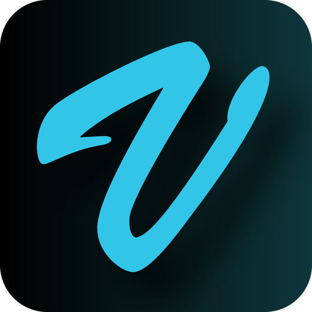

<p align="center">
  
</p>

<h1 align="center">Velocity Studio</h1>

<p align="center">
  <b>An OBS-style screen recorder and live streamer for Windows.</b><br>
  Scenes, an audio mixer, NVENC hardware encoding, and one-click streaming to Twitch, YouTube, Kick and more.
</p>

<p align="center">
  <a href="https://github.com/colebolebole/velocity-studio/releases/latest"></a>
  <a href="LICENSE"></a>
  
  
  
  
  
  
</p>

<p align="center">
  <a href="https://github.com/colebolebole/velocity-studio/releases/latest"><b>Download</b></a> ·
  <a href="#features">Features</a> ·
  <a href="#building-the-installer">Build</a> ·
  <a href="#license">License</a>
</p>

---

## Download
Grab `Velocity Studio Setup <version>.exe` from the [latest release](https://github.com/colebolebole/velocity-studio/releases/latest) and run it (per-user install, no admin rights needed). The installer is **unsigned**, so Windows SmartScreen may warn about an unknown publisher.

**Run from source:** double-click `VelocityStudio.bat` (or `npm start`).

## Features
- **Scenes & sources** - display, window, webcam, image, text and colour sources; drag / resize / crop (Alt+drag) / snap in the live preview; per-source opacity, flip, lock, visibility, z-order, undo on delete.
- **Audio mixer** - System audio (Windows loopback) + any number of microphones / capture devices / virtual cables, stereo peak meters, faders (-60..+12 dB), mute. Switch each channel's source from the gear button or Settings -> Audio; channels recover automatically when devices change.
- **Live streaming** - Twitch, YouTube Live, Facebook Live, Kick, Restream, or any custom RTMP/RTMPS ingest (TikTok, Instagram, X, Rumble...). Encodes with NVENC, AMD AMF or Intel Quick Sync (or x264 on the CPU, with a selectable preset), CBR with 2 s keyframes, optional downscale / lower fps, auto-reconnect. Stream keys are encrypted with Windows DPAPI and never written to the settings file. Streaming and recording can run at once.
- **Hardware & software encoding** - NVIDIA NVENC, AMD AMF and Intel Quick Sync (H.264, HEVC and AV1 where the GPU supports it), plus x264 / x265 on the CPU. Each encoder is auto-detected; Settings -> Output lets you pick Automatic, Hardware, Software or Built-in, then the encoder, its own presets, VBR / CBR / constant quality and the keyframe interval. Frames are converted to NV12 on the GPU and piped to ffmpeg.
- **Encoder benchmark** - on first launch (and whenever the graphics card changes) Velocity Studio times real encodes at your output resolution and frame rate with every encoder your PC supports, finds the best-quality preset each one sustains in real time, and recommends a recording profile and streaming encoder. Works on any GPU or CPU-only PC; re-run it any time from Settings -> Output.
- **Recording** - also Chromium's H.264, VP9, VP8 and AV1 encoders as a fallback; 720p-4K at 24-60 fps; MP4 / MKV / WebM; bitrate control; pause/resume; streamed straight to disk.
- **Global hotkeys** - F9 start/stop recording, F10 pause, F11 screenshot, plus an optional start/stop streaming key (all rebindable in Settings).
- **Taskbar indicator** - the taskbar button shows a red dot while recording, amber bars when paused, a cyan dot while live, and a progress bar while a recording is being saved; the window title mirrors it.
- **Hides itself** from captures (no infinite mirror), optional minimise-on-record.
- Keeps recording while minimised or covered by other windows.
- Opens with a short logo animation, and the installer launches the app when it finishes.

Recordings go to `Videos\Velocity Studio` by default (Settings -> Output).

## Building the installer
Builds a Windows NSIS installer (`dist\Velocity Studio Setup <version>.exe`) from the current working folder.

1. Install dependencies (first time only): `npm install`
2. Bump the version - the installer name and version come from `package.json`, and the build never changes it:
   ```powershell
   npm version patch --no-git-tag-version
   ```
   (use `minor` or `major` instead of `patch` as needed)
3. Build:
   ```powershell
   npm run dist
   ```

The installer is a one-click, per-user install and is **unsigned**. `dist/` is gitignored and previous installers are not cleaned up, so delete old ones by hand if you don't want them.

## License
[MIT](LICENSE). Velocity Studio bundles Electron (MIT) and an ffmpeg build via `ffmpeg-static`; ffmpeg is licensed separately (GPL for the bundled build) - see the ffmpeg project's licensing terms if you redistribute the installer.

## Notes
- `npm run selftest` records a 5 s clip and exits (used to verify the capture pipeline).
- `node scripts/make-splash-v.js` regenerates `src/logo-v.png` (the V used by the startup animation) from `src/icon.png`.
- After a fresh `npm install`, npm may skip install scripts; if `node_modules\electron\dist` is missing run `node node_modules\electron\install.js`.
